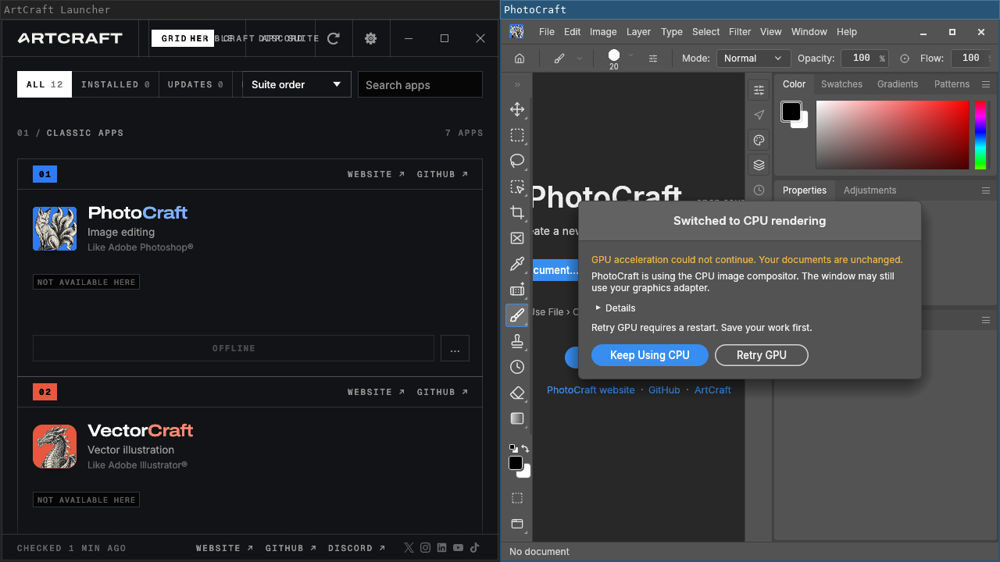

# Linux compatibility and verification

CraftPulse detects ArtCraft processes, including payloads launched from AppImages,
without requiring a particular Linux kernel version or installation directory.
It groups helper processes with their application, preserving the process that
owns the focused window. The launcher itself is not a creative application.

## Desktop capabilities

| Session | Window activity | Idle |
| --- | --- | --- |
| X11 | `xprop` (install `xorg-xprop`) | `xprintidle` |
| Sway | `swaymsg` | Wayland idle protocol |
| Hyprland | `hyprctl` | Wayland idle protocol |
| niri | `niri msg` | Wayland idle protocol |
| KDE Wayland | `kdotool`, focused window | Wayland idle protocol |
| GNOME Wayland | Process detection; app control API for detailed activity | GNOME idle monitor |
| Other Wayland compositors | Process detection; app control API for details | Requires supported idle protocol |

Full tool/document detail depends on the individual ArtCraft app exposing its
control API. Enable live detection in Settings, then log out and in and restart
the launcher so child apps inherit the saved environment. The UI distinguishes
saving this environment from successfully importing it into the current session.
A desktop tray extension may be needed to display the tray icon on GNOME.
Sandboxed Discord must expose a reachable Discord IPC socket.

## Build on Arch

Install `base-devel rust gtk3 webkit2gtk-4.1 libayatana-appindicator xdotool git`.
Run `cargo build --release --locked`. The binary is `target/release/craftpulse`.
The VCS PKGBUILD under `packaging/arch` follows the repository's default branch;
it will contain these changes after they are merged.

For the automated headless Wayland checks also install `python sway dbus` and
run `bash scripts/check_arch.sh` as an ordinary user. The script checks Rust
regressions, strict Clippy, native WebKit settings rendering, Wayland idle, and
an end-to-end test using a simulated AppImage payload and Discord IPC peer.
The simulated test does not verify a real ArtCraft application's control API.
`.github/workflows/arch.yml` runs this on rolling Arch; the other workflow builds
Linux, Windows and macOS. CI results must be checked separately from local results.

## Local evidence (2026-10-17)

- Debian 13 host, kernel 6.18.44: 184 tests passed, 2 display tests ignored by default.
- Both display tests then passed separately under headless Sway: Wayland idle
  notification and native WebKit settings page, including preview buttons.
- Strict Clippy and debug build passed.
- Native settings-window and simulated AppImage smoke checks also passed under
  Xvfb/X11. The X11 smoke checks idle configuration, not elapsed idle detection.
- End-to-end smoke passed with both a simulated AppImage payload and real
  PhotoCraft 0.9.0: editing/idle presence, buttons over mock Discord IPC, API
  authentication, settings persistence, and partial session-setup failure.
  The real app was launched directly from extracted AppImage contents, not
  installed through the launcher. Its detailed control API was not exercised.
- Official launcher 0.3.2 x86-64 AppImage: published SHA256 matched and its real
  window opened under Sway using extracted AppImage contents (no FUSE available).
- Rolling Arch container `20261011.0.609700` starts, but package installation is
  blocked by this cloud environment's mirror network restriction. A container
  shares its host kernel and does not reproduce another machine's exact desktop.

These checks do not establish compatibility with every desktop or ArtCraft
release. Check the workflow run for actual Arch build results.

The launcher is offline in this cloud environment. PhotoCraft uses CPU rendering
because the test host has no GPU. [Captured CraftPulse diagnostics](docs/testing/photocraft-presence.json)
show the detected app and presence. To repeat the smoke check against an already
running real PhotoCraft, set `CRAFTPULSE_USE_RUNNING_PHOTOCRAFT=1`; otherwise it
creates a simulated AppImage process. Both modes use a mock Discord peer.
